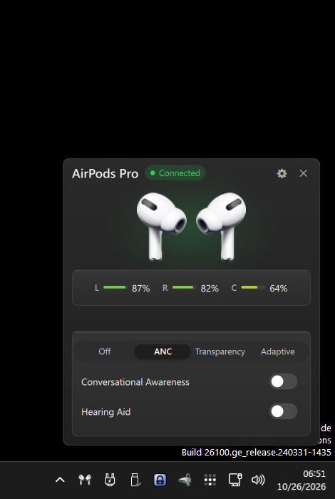
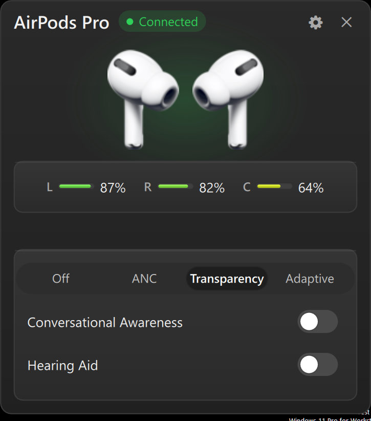
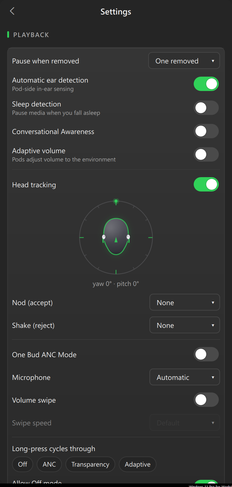
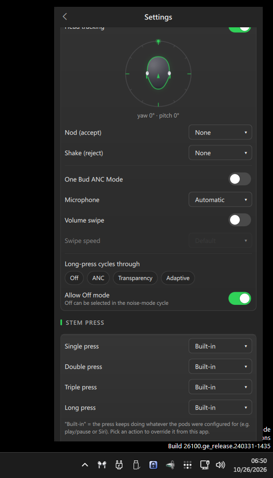
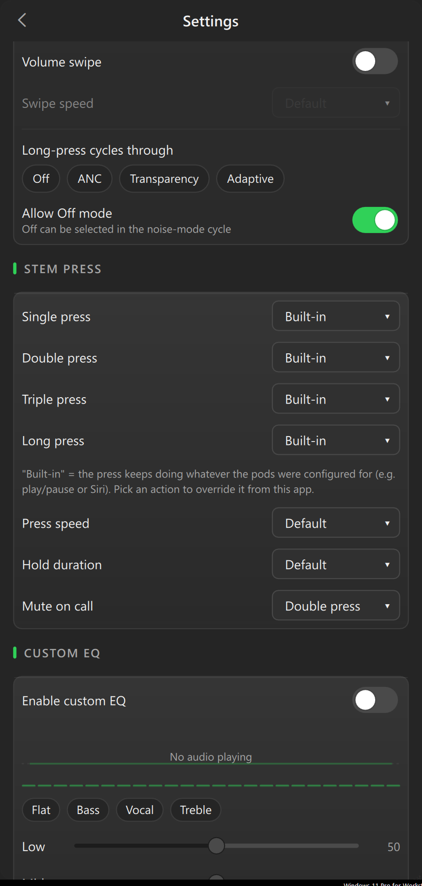
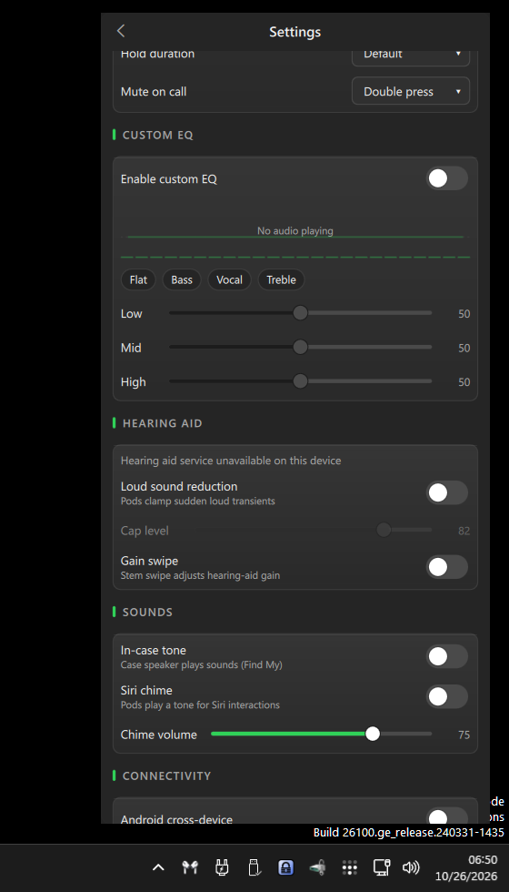
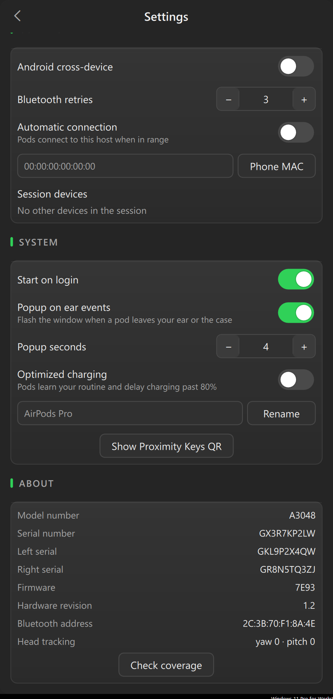

# LibrePods for Windows

**AirPods on Windows, done properly.** Battery levels, noise-control modes,
ear detection, head gestures, stem-press remapping, a custom EQ, hearing-aid
tuning, and head tracking — all from a small system-tray app.

A Windows port of [LibrePods](https://github.com/kavishdevar/librepods)
(Android / Linux) by **Kavish Devar**. All credit for the AirPods protocol
research, packet layouts, and original implementation goes to the upstream
project; `windows/shared/` carries the shared sources over from the Linux
tree. Featured on [raab.ing](https://raab.ing/main/projects/librepods-windows/).



## Download

**[LibrePods for Windows v0.1.0](../../releases/latest)** — unzip, run
`install.cmd` as administrator, done. The package contains the app, the
kernel driver it needs, and `INSTALL.txt` with full notes.

> **One-time requirement:** the AirPods control channel (L2CAP/AACP) is not
> reachable from user-mode code on Windows, so the app talks through a small
> KMDF kernel driver. That driver is **test-signed**, which means
> **Secure Boot must be off** and Windows **test-signing must be on** for it
> to load. The installer sets test-signing and trusts the cert for you —
> you'll get the standard "Test Mode" desktop watermark. There is no way
> around this without a Microsoft-attested driver signature.

## What it does

- **Noise control** — Off / ANC / Transparency / Adaptive, one click from
  the tray flyout:

  
- **Battery** — left / right / case levels and charging state at a glance,
  live in the flyout.
- **Ear detection** — pause when a pod leaves your ear, configurable
  (one removed / both removed / off), sleep detection, conversational
  awareness, adaptive volume:

  
- **Head tracking & gestures** — live orientation readout, plus nod/shake
  gestures mappable to play-pause, next/previous track, volume, or
  noise-mode cycling:

  
- **Stem-press remapping** — single/double/triple/long press each get an
  assignable action (or keep the pod's built-in behavior), press speed,
  hold duration, mute-on-call:

  
- **Custom EQ** — low/mid/high sliders + presets, written straight to the
  pods. **Hearing aid** — loud-sound reduction cap, gain swipe. **Sounds** —
  in-case tone (Find My), Siri chime, chime volume:

  
- **Connectivity & system** — Android cross-device relay, automatic
  connection, session (TiPi) device list, start-on-login, ear-event popups,
  optimized charging, rename, proximity-keys QR:

  

It also keeps working at reduced function **without** the driver: AirPods
broadcast a BLE proximity advertisement whose plaintext fields carry the
device name/model, pod battery (10 % steps), case battery (lid open or pod
inside), charging flags, and in-ear state — all still shown.

## Install

1. Download and unzip the release.
2. **Pair your AirPods** in Windows Settings → Bluetooth (open the lid,
   hold the case button).
3. Right-click **`install.cmd` → Run as administrator**. It installs the
   KMDF driver (imports the test cert, enables test-signing, installs the
   INF) and drops the app into `%LOCALAPPDATA%\LibrePods` with a Start Menu
   shortcut.
4. **Reboot once** if it says so (required the first time test-signing is
   turned on). Then launch **LibrePods** from the Start Menu — it lives in
   the system tray at the bottom-right.

Uninstall, troubleshooting, and the Secure Boot details are in the zip's
`INSTALL.txt`.

## Using it

- **Left-click the tray icon** (or click the icon that looks like earbuds)
  to open the flyout next to the clock: battery bars, the noise-mode row,
  and quick toggles.
- **Gear icon** in the flyout opens Settings — everything above lives there,
  organized into Playback / Stem press / Custom EQ / Hearing aid / Sounds /
  Connectivity / System / About.
- **`librepods-ctl`** (same folder) drives a running instance from scripts:
  `librepods-ctl noise:anc|noise:off|noise:transparency|noise:adaptive|reopen`.
- **`--debug`** verbose logging, **`--hide`** starts minimized to tray.
- Logs append to `librepods.log` next to the exe (rotates at 5 MB);
  crashes write `librepods-crash-*.dmp` minidumps.

## Supported devices

AirPods Pro / Pro 2 are the primary target (ANC, transparency, adaptive,
stem, head tracking, hearing-aid path). Other models connect and get
battery + ear detection + mode switching; the per-model extras degrade
gracefully.

## Known limitations

- **Test-signed driver** — Secure Boot off + test-signing on is mandatory
  for the control channel (see above). Without the driver the app still
  shows BLE-advertised battery/status but cannot switch ANC.
- **Audio routing** — Windows owns A2DP/hands-free profile switching; do it
  in Sound settings. The app controls the *pods*, not Windows audio.
- **Head tracking** — decode is experimental; the live readout and gesture
  detection work, absolute orientation may need a recenter.

## Building from source

- **App**: Qt 6.8 (Quick, Qml, Bluetooth — llvm-mingw kit), CMake, Ninja:

  ```
  cmake -B build -G Ninja -DCMAKE_PREFIX_PATH=C:/Qt/6.8.3/llvm-mingw_64 `
        -DCMAKE_C_COMPILER=C:/Qt/Tools/llvm-mingw1706_64/bin/clang.exe `
        -DCMAKE_CXX_COMPILER=C:/Qt/Tools/llvm-mingw1706_64/bin/clang++.exe
  cmake --build build
  ```

  → `build/librepods.exe`, `librepods-svc.exe`, `librepods-ctl.exe`.
  (llvm-mingw clang is required — GCC's libstdc++ ABI doesn't match this Qt.)
- **Driver**: Visual Studio 2022 + the NuGet-restored WDK — see
  `windows/driver/kmdf/README.md` (`driver-build.cmd bthl2cap`).

## License & credit

GPL-3.0 — same as upstream (`LICENSE`). Original project:
[kavishdevar/librepods](https://github.com/kavishdevar/librepods) —
the protocol reverse-engineering and Android/Linux implementation are all
upstream's work; this repo adds the Windows port. KMDF driver derives from
[ivLis-Studio/librepods-windows](https://github.com/ivLis-Studio/librepods-windows)
(GPLv3).
